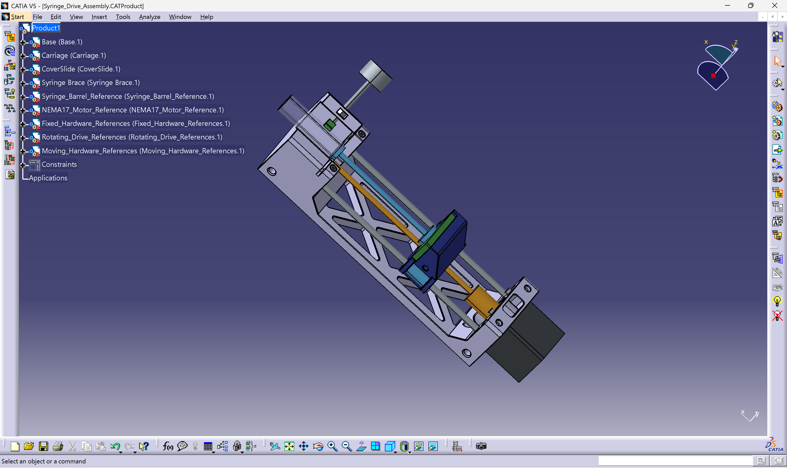
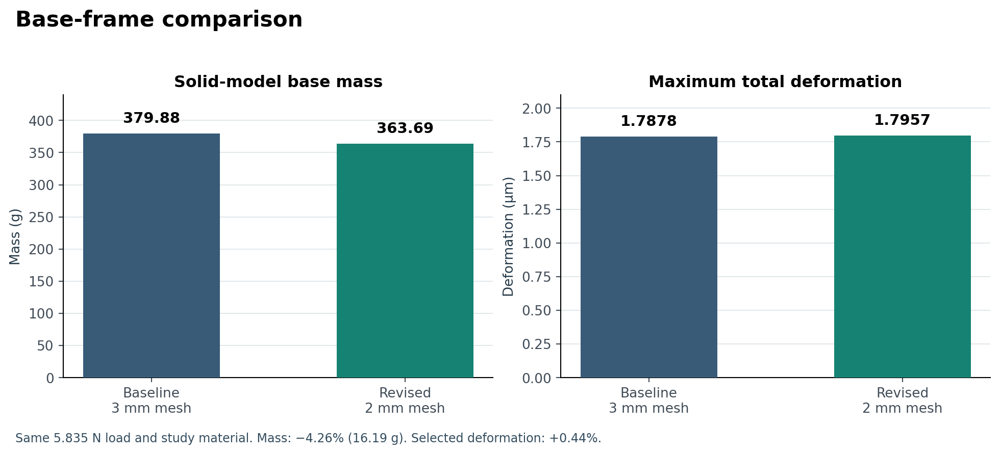
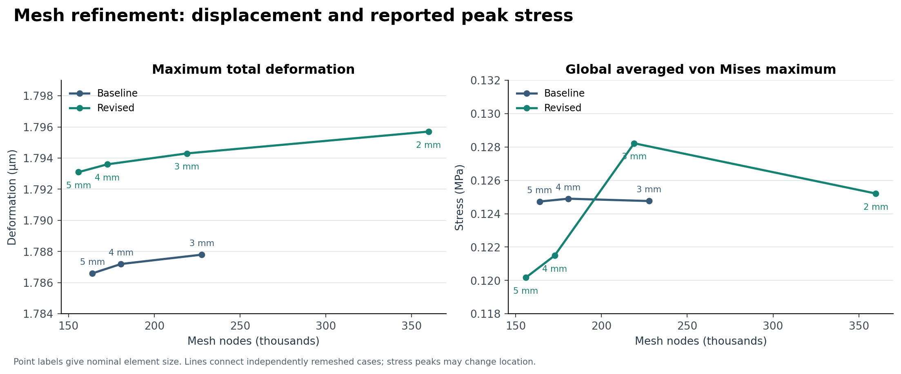

# Syringe Drive - CAD, Actuator Sizing and FEA

**Ayaz Hussain | CATIA V5 · Ansys Mechanical · Python**

I assembled the mechanism in CATIA, added reference hardware and position constraints, and linked a Python actuator-sizing model to a structural comparison of the base frame.

The design change is a **2 mm underside relief**, reducing the central frame thickness from **10 mm to 8 mm** while retaining the end mounting regions. It reduces the modelled base mass by **16.19 g (4.26%)**. Under the same **5.835 N axial load**, the selected FEA results show a **0.44% increase in maximum deformation**.



## Work completed

- Assembled and constrained the mechanism, with reference geometry for the syringe, motor, guides, coupling and fasteners.
- Checked three carriage positions over a 60 mm offset range.
- Prepared separate baseline and revised base solids, including dimensional checks of the relief and remaining thickness.
- Wrote a parametric force, screw-torque and flow-rate calculation with pressure and efficiency sweeps.
- Applied the calculated axial load to a base-only Ansys model and compared seven mesh cases.
- Reviewed deformation, averaged equivalent stress, reaction balance and mesh quality.

## Base-frame comparison

| Quantity | Baseline | Revised |
|---|---:|---:|
| Central frame thickness | 10 mm | 8 mm |
| Solid-model base mass | 379.88 g | 363.69 g |
| Selected nominal element size | 3 mm | 2 mm |
| Maximum total deformation | 0.0017878 mm | 0.0017957 mm |
| Maximum averaged von Mises stress | 0.12476 MPa | 0.12521 MPa |
| Total support reaction | 5.835 N | 5.835 N |

Mass is calculated for the base alone using a homogeneous density of 1240 kg/m³. The comparison uses the selected mesh for each design. At the common 3 mm setting, the revised deformation is **0.36% higher** than baseline.



The result supports the relief as a useful mass-saving change for this load case: the displacement response changes little while the modelled mass falls by 4.26%. Both selected peak stresses are approximately 0.125 MPa. Their small difference is comparable with the observed mesh sensitivity, so the stress values do not establish a strength ranking between the designs.

## Actuator sizing

The sizing model uses a 14.57 mm reference bore, 60 mm active stroke and an M5 × 0.8 single-start screw.

| Study quantity | Result |
|---|---:|
| Reference swept volume | 10.0037 mL |
| Total axial force at the assumed study point | 5.8346 N |
| Quasi-static screw torque at 20% efficiency | 3.7144 N·mm |
| Torque target with a 2× sizing multiplier | 7.4288 N·mm |
| Screw speed at 1 mL/min | 7.4972 rpm |
| Ideal displacement per full step | 0.004 mm |
| Ideal volume per full step | 0.6669 µL |

The study point assumes 20 kPa back pressure, 2 N seal friction and 0.5 N guide drag. The force applied in FEA is rounded to 5.835 N. The multiplier applies to torque demand only. Step volume is a geometric calculation; dispensing accuracy would require measurement.

[Calculation method and inputs](calculations/README.md) · [Force/torque sensitivity plot](calculations/results/force_torque_sensitivity.png)

## Structural model and mesh refinement

The base is represented by a linear elastic, isotropic PLA study material: **E = 3 GPa**, **ν = 0.35** and **ρ = 1240 kg/m³**. A total force of **−5.835 N in global X** acts across four screw-head bearing seats. A fixed support covers four split cylindrical faces on the two lower mounting bores.

Baseline meshes use 5, 4 and 3 mm nominal sizes; revised meshes use 5, 4, 3 and 2 mm. The last revised refinement changes maximum deformation by **+0.078%** and the global averaged stress maximum by **−2.35%**.



The displacement response is stable over the sampled meshes. Peak stress varies non-monotonically; the 2.35% final change is an observed sensitivity, not an absolute error estimate. The [engineering note](docs/engineering-note.md) records the complete results, element-count convention and solver-warning review.

## Read the study

- [Technical report - PDF](docs/Syringe_Drive_Study.pdf)
- [Engineering note](docs/engineering-note.md)
- [CAD configuration and travel views](docs/cad-study.md)
- [Proposed bench verification](docs/verification-plan.md)
- [Results CSV](analysis/fea_results.csv) and [evidence index](evidence/README.md)

The material model represents a homogeneous solid. Print orientation, infill, joint compliance and measured drag remain separate considerations when moving from the calculation to a physical mechanism.

## Run the calculations

Python 3.10 or later:

```bash
python calculations/syringe_sizing.py
python -m unittest discover -s tests -v
```

To regenerate the figures and report:

```bash
python -m pip install -r requirements.txt
python calculations/syringe_sizing.py --plot
python scripts/plot_study.py
python scripts/render_report.py
```

## Design note

Selected component geometry was adapted from an existing model. The work presented here covers the CATIA assembly and reference hardware, base revision, actuator calculations and structural comparison. Applicable notices are retained in [THIRD_PARTY_NOTICES.md](THIRD_PARTY_NOTICES.md).
