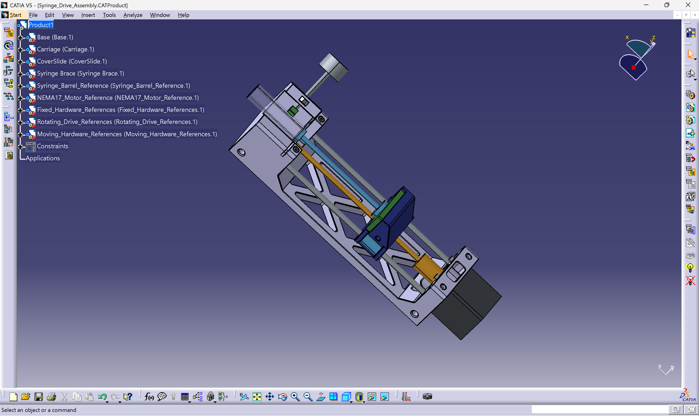
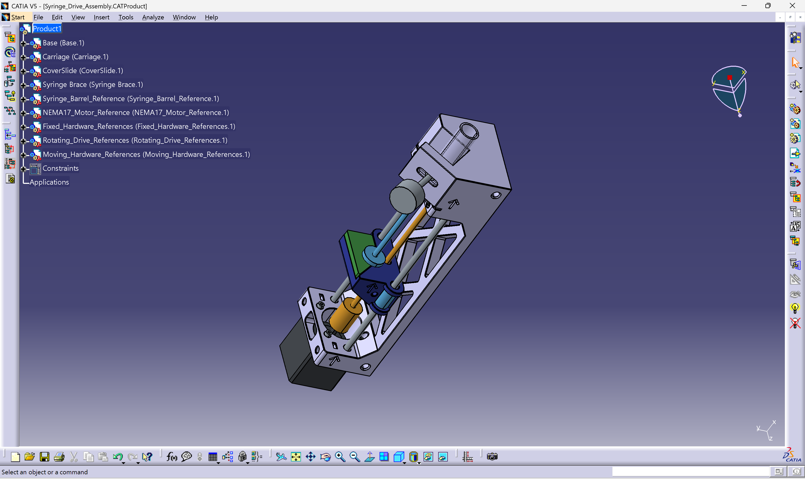
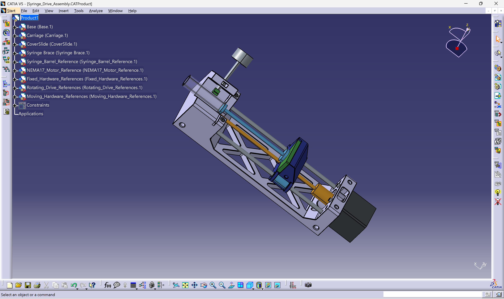
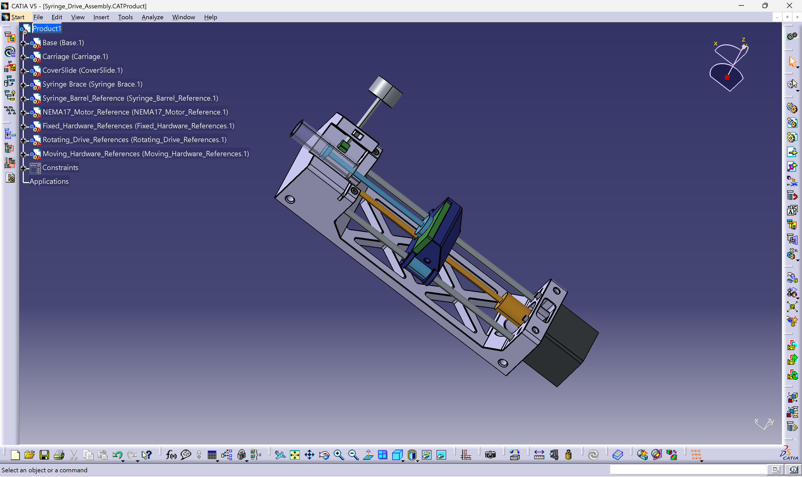
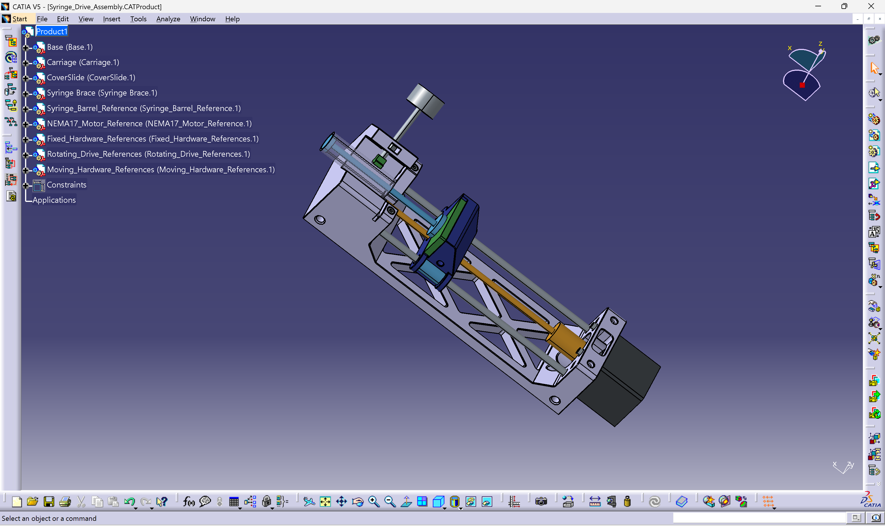
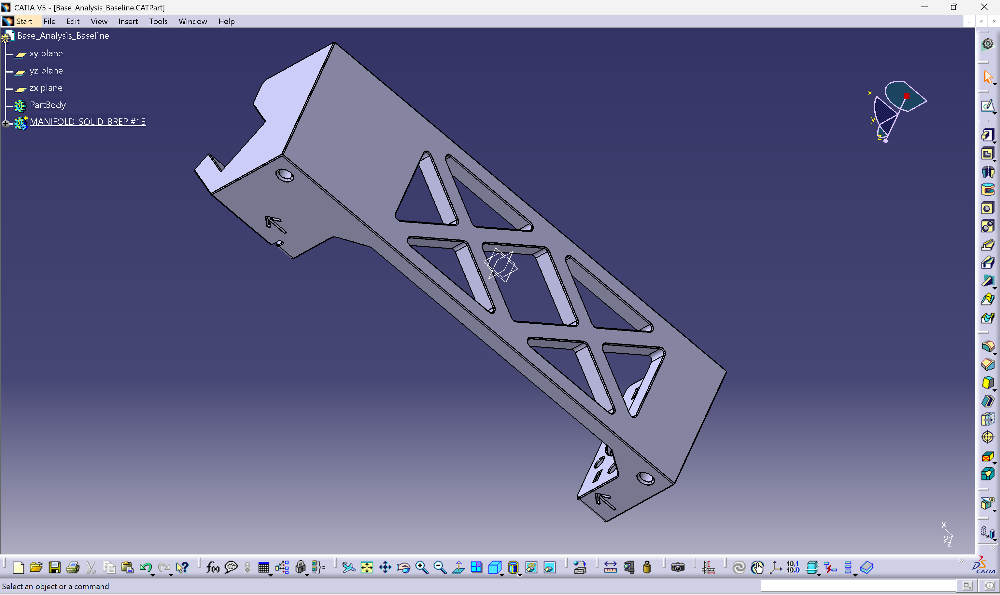
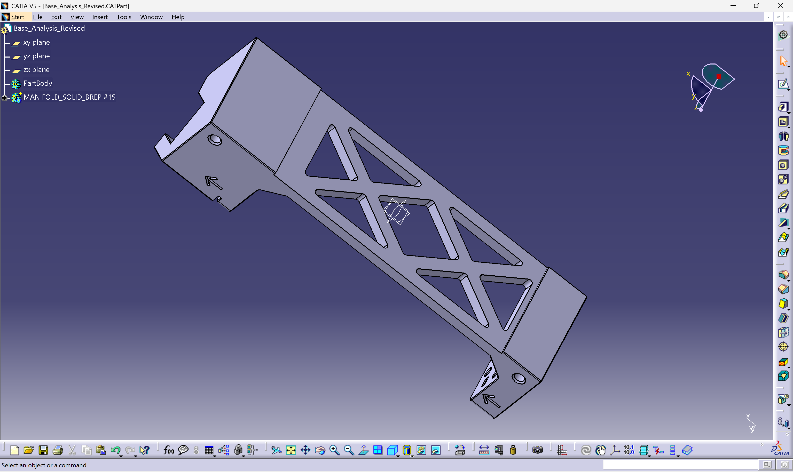
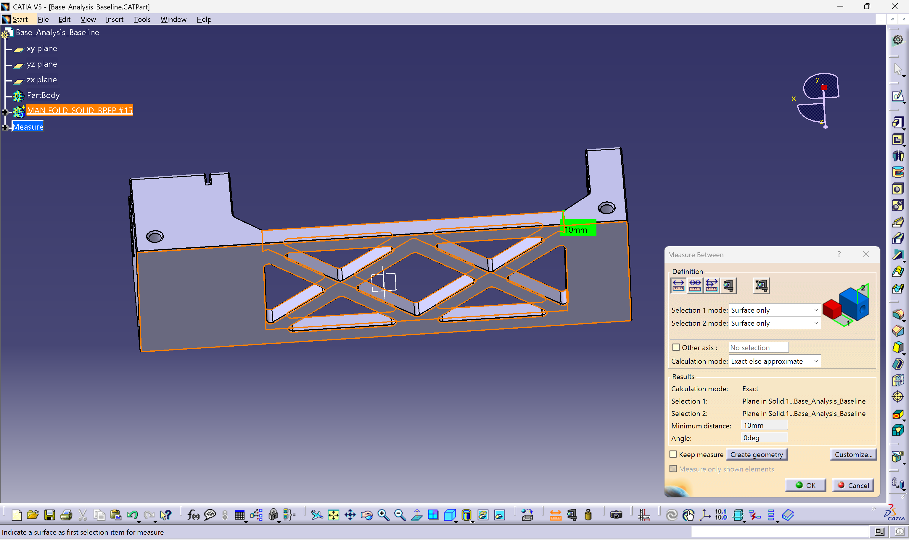
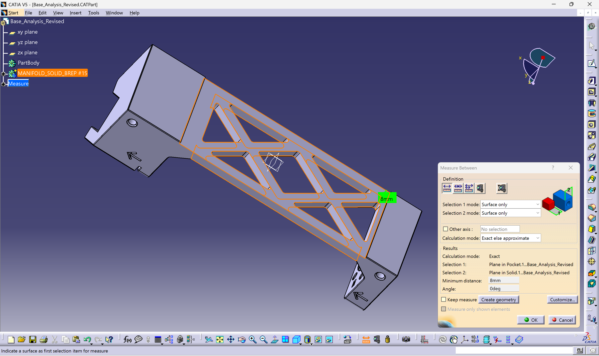

# CAD configuration and base revision

The CATIA assembly contains the syringe reference, carriage, cover slide, barrel brace and simplified drive hardware. The reference parts establish the geometry and interfaces used for the sizing study.

The constraint record shows the fixed base, guide-axis alignment, contact relationships and a carriage-position offset. The assembly is positioned through this existing offset; the travel images are manual position checks.

## Assembly

[Side view](../evidence/screenshots/cad_assembly_side.png) · [Constraint record](../evidence/screenshots/cad_constraints_display.png)

## Carriage positions

The offset settings 54, 84 and 114 mm span a 60 mm position range. The illustrated positions document the carriage arrangement. They do not constitute a screw-motion simulation or a formal interference analysis.

| 54 mm offset | 84 mm offset | 114 mm offset |
|---|---|---|
|  |  |  |

## Controlled base-frame change

A separate baseline base part was retained. The revised analysis part adds a 2 mm underside pocket over a 170 × 74 mm sketch envelope, leaving the end mounting regions in place.

| Baseline underside | Revised underside |
|---|---|
|  |  |

The measured central thickness changes from 10 mm to 8 mm.

| Baseline measurement | Revised measurement |
|---|---|
|  |  |

[Pocket definition](../evidence/screenshots/cad_pocket_definition.png) · [Pocket sketch](../evidence/screenshots/cad_pocket_sketch.png)

The solid-model mass values in the analysis refer only to the base. The assembly images show the reference layout; the revised base is documented as its own structural variant.
